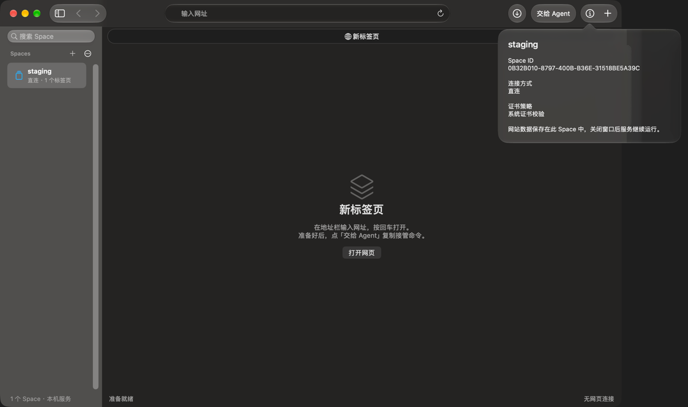

# Agent WebKit

Agent WebKit 是一款给本机 AI Agent 使用的 macOS 浏览器。你可以在窗口里看着 Agent 操作，也可以先自己登录网站，再把当前标签页交给它。每个 Space 有独立的网站数据、标签页和代理设置，多个 Agent 可以各用一个 Space，同时工作。



## 安装应用

需要 Apple Silicon Mac、macOS 14 或更高版本，以及已登录的桌面会话。

```sh
brew install --cask viko16/tap/agent-webkit
```

在「应用程序」中打开 Agent WebKit。首次打开若被 macOS 拦截，可在「系统设置 → 隐私与安全性」中选择「仍要打开」。

## 给 Agent 安装 Skill

运行这条命令，即可全局安装 Skill，供本机所有项目中的 Agent 使用。命令需要 Node.js 和 npm。

```sh
npx --yes skills add viko16/agent-webkit --skill agent-webkit -g -y
```

新开一个 Codex 对话，试试这句话（Pi 中把开头换成 `/skill:agent-webkit`）。

> $agent-webkit 用一个新的直连 Space 打开 <https://example.com>，告诉我页面标题。

Skill 会引导 Agent 读取页面、操作元素并核对结果。如果你想在终端直接操作，Homebrew 也会一并安装 `awb`，运行 `awb --help` 或 `awb help` 即可查看命令。

## 把当前标签页交给 Agent

在地址栏输入网址（本地地址如 `localhost:5173` 默认走 HTTP，其他地址默认走 HTTPS），完成登录等需要手动操作的步骤。点击工具栏的「交给 Agent」，把复制的接管命令和任务一起发给 Agent，例如「列出这页还没勾选的待办事项」。命令里带有当前 Space 和标签页的编号，你切换到其他标签页后，Agent 仍会操作原来的页面。

- **标签页与导航**：支持后退/前进（`⌘[` / `⌘]`）、停止加载（`⌘.`）、页内查找（`⌘F`）、缩放（`⌘+` / `⌘-` / `⌘0`）、`⌘1`–`⌘9` 切页以及标签页右键菜单和中键关闭。多页时 `⌘W` 关闭当前页，只剩一页时隐藏观察窗口；`⇧⌘W` 始终隐藏窗口；每个 Space 至少保留一页。沙漏表示该页正在执行操作，执行中或 Space 正忙时无法关闭；关闭近 5 分钟内有 Agent 活动的标签页时会先确认。Space 内有 Agent 操作执行时，网页缩放也会暂停。页面错误较长时，点「展开」或按 `⇧⌘E` 查看并复制完整信息。
- **网页对话框与下载**：网页请求 `alert`/`confirm`/`prompt` 时，可以直接在当前页应答，支持显示待处理队列与自动超时倒计时。从工具栏「下载」或菜单「窗口 → 查看下载」可按标签页查看当前 Space 的任务、取消下载或在访达中显示已完成文件。Agent 固定视口后，可点底栏「预览」查看完整画面并随时刷新。
- **Space 管理**：从「文件 → 新建 Space…」或侧栏「＋」创建 Space。「Space」菜单可查看信息、复制当前 Space ID、休眠、恢复和删除；侧栏也提供管理入口。Space 信息面板可一键复制 Space/Tab ID 与代理地址，查看证书策略和 CA 指纹，并直接开关当前页的 Safari 网页检查器。休眠保留地址、Cookie 和 LocalStorage；删除会清除登录状态和网站数据。
- **后台运行与代理**：关闭窗口后 Agent 可继续在后台工作；退出应用后已保存的网站数据会保留，未提交的表单可能丢失。如果开启了系统代理，直连 Space 会暂停，关闭系统代理后点「重新检查」即可恢复。调试本地项目时，可给 Space 单独配置 Whistle，见 [Whistle 与 Vite 配置示例](docs/DEVELOPMENT.md#whistle-与-vite-配置示例)。

[开发说明](docs/DEVELOPMENT.md) · [实现依据](docs/RESEARCH.md) · [MIT 许可证](LICENSE) · [第三方许可](THIRD_PARTY_NOTICES.md)
